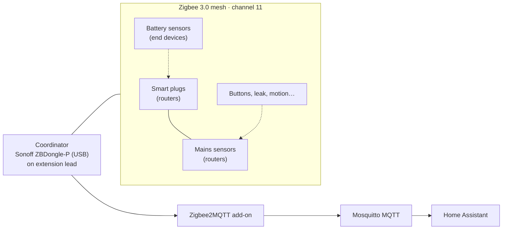

# Zigbee Network Migration: ZHA to Zigbee2MQTT, Mesh Optimisation and RF Channel Planning

**Migrating a home Zigbee network from Home Assistant's built-in ZHA to Zigbee2MQTT on an MQTT backbone, then commissioning it properly: re-pairing every device, checking the mesh map and link quality, planning the RF channel against the Wi-Fi access points, and fixing the faults that only show up in a live network.**

> **The short version:** the Zigbee network (**93 devices**) moved from ZHA to **Zigbee2MQTT**, publishing every device onto the **Mosquitto** MQTT broker that later also carried the RAMSES-II, rtl_433 and BLE-scanner traffic. Every device was re-paired. The mesh was then tuned using Z2M's network map and link-quality figures: mains-powered plugs as routers, power-cycling routers that held poor routes, and keeping the coordinator away from USB 3 interference. The channel (11) was checked against the Wi-Fi APs. Faults found in service included onboarding failures, sensors over-reporting, and **availability noise firing automations**.

**Portfolio position:** Field level · wireless field network commissioning. The equivalent of commissioning a wireless BMS sensor network or a Zigbee/EnOcean lighting system. Related: [HA integration schedule](https://github.com/the-control-cabinet/home-assistant-integration-schedule) · [BLE presence network](https://github.com/the-control-cabinet/esp32-ble-presence-network)

---

## 1. Why migrate

| ZHA (before) | Zigbee2MQTT (after) |
|---|---|
| Built into HA; devices visible only inside HA | Devices published on **MQTT**, so they're visible to any MQTT client and debuggable with standard tools |
| Limited network visibility | **Network map**, link quality per hop, per-device reporting settings |
| Device support tied to HA releases | Large external device database, quick support for new models |
| Coupled to the HA process | Runs as its own add-on, so HA restarts don't drop the radio network |

The architecture choice: **one MQTT backbone with protocol gateways onto it**, the same pattern as a BMS IP backbone with field-bus gateways.

## 2. Architecture

## 3. Migration procedure

1. **Inventory** every ZHA device: name, area, and which automations use it.
2. **Install Mosquitto**, then the **Zigbee2MQTT** add-on with the coordinator's serial path.
3. **Stop ZHA's use of the coordinator.** A radio can only belong to one stack.
4. **Re-pair every device** into Z2M, closest routers first so the mesh builds outwards. End devices go last, near their final routers.
5. **Rename** to the previous naming scheme so automations keep working; update any entity IDs that changed.
6. **Verify** each device reports in HA through MQTT discovery.
7. **Commission the mesh:** network map, link quality, routes (section 5).
8. **Tidy up:** the leftover ZHA config entry is still listed in HA and is on the backlog for removal.

## 4. Device estate

| Category | Power | Mesh role | Notes |
|---|---|---|---|
| Smart plugs | Mains | **Router** | Backbone of the mesh; reporting intervals set |
| Motion / presence | Battery / mains | End device / router | |
| Temperature / humidity | Battery | End device | One model pairs only via a **pinhole** button |
| Water leak | Battery | End device | |
| Soil moisture | Battery | End device | |
| Air quality (CO2/VOC, PM2.5) | Mains | Router | CO2/VOC sensor needed a **reporting throttle** |
| Vibration | Battery | End device | Appliance cycle detection (sub-metering) |
| Wireless buttons | Battery | End device | Event-based automations |

Data: [data/device-types.csv](data/device-types.csv). **93 Zigbee devices** in total. The MQTT broker also carries ESPHome, RAMSES-II and RF traffic alongside.

## 5. Mesh optimisation and RF planning

| Topic | Practice applied |
|---|---|
| **Routers first** | Mains devices (plugs, powered sensors) provide the routing backbone; battery devices attach to them |
| **Link quality** | Z2M's network map shows link quality per hop. Low-quality routes were found where better neighbours existed |
| **Power-cycling routers** | Forces devices to re-evaluate routes. Fixed a poorly routed area; others were identified for the same treatment |
| **Coordinator placement** | **USB 3 ports radiate 2.4 GHz noise**, so the dongle is on a **USB extension lead** (fitted) away from the host |
| **Channel planning** | Zigbee on **channel 11**, checked against the Wi-Fi APs on channels 3, 4, 7, 9 and 10. Zigbee and Wi-Fi share the 2.4 GHz band, so overlap means lost packets |
| **Reporting tuning** | Reporting intervals on plugs; throttle on chatty sensors to protect the mesh and the recorder |

## 6. Issues dealt with

| # | Issue | Cause | Fix | Lesson |
|---|---|---|---|---|
| 1 | A sensor wouldn't pair | That model only pairs via a hidden pinhole button | Pinhole reset/pair | Check the device's pairing method in the database |
| 2 | Devices stuck at onboarding | Onboarding state didn't complete | Z2M `force_onboarding` fix | Know the stack's recovery options |
| 3 | **Automation fired with nobody present** | Z2M **availability tracking** cycled a device offline/online, and HA saw a state change with stale timestamps | Availability tracking disabled globally; automation rebuilt on proper event triggers | Device-availability noise can look like real events, so trigger on events, not on state flaps |
| 4 | Sensor flooding updates | CO2/VOC sensor reporting continuously | `throttle: 60` | Rate-limit chatty field devices |
| 5 | Weak links in parts of the house | Poor routes and coordinator RF noise | Router power-cycling; USB extension | Commission the mesh, don't just pair it |
| 6 | Unidentified device on the network | An unknown device found in the inventory | Identified and named | Keep a device register |

## 7. Roadmap
- [ ] Remove the leftover ZHA integration entry.
- [ ] Power-cycle the remaining low-link-quality routers; re-check the map.
- [ ] Apply reporting intervals across all plugs.
- [ ] Network backup schedule for the coordinator.

## 8. Skills demonstrated

| Skill | Evidence |
|---|---|
| Wireless field network migration | ZHA → Z2M with no loss of device function |
| Mesh commissioning | Routers first, network map, link quality, route repair |
| RF planning | Zigbee vs Wi-Fi channel separation; USB 3 noise avoidance |
| Gateway / backbone architecture | Zigbee onto a shared MQTT bus |
| Fault diagnosis | Availability-noise false triggers traced and fixed |
| Device register discipline | Inventory, naming, reporting settings |

📺 [The Control Cabinet on YouTube](https://www.youtube.com/channel/UC5Cupmz7vlfcodpCX7k8iuQ)

*Built and documented by James · part of [The Control Cabinet BMS portfolio](https://github.com/the-control-cabinet). MIT Licence.*
